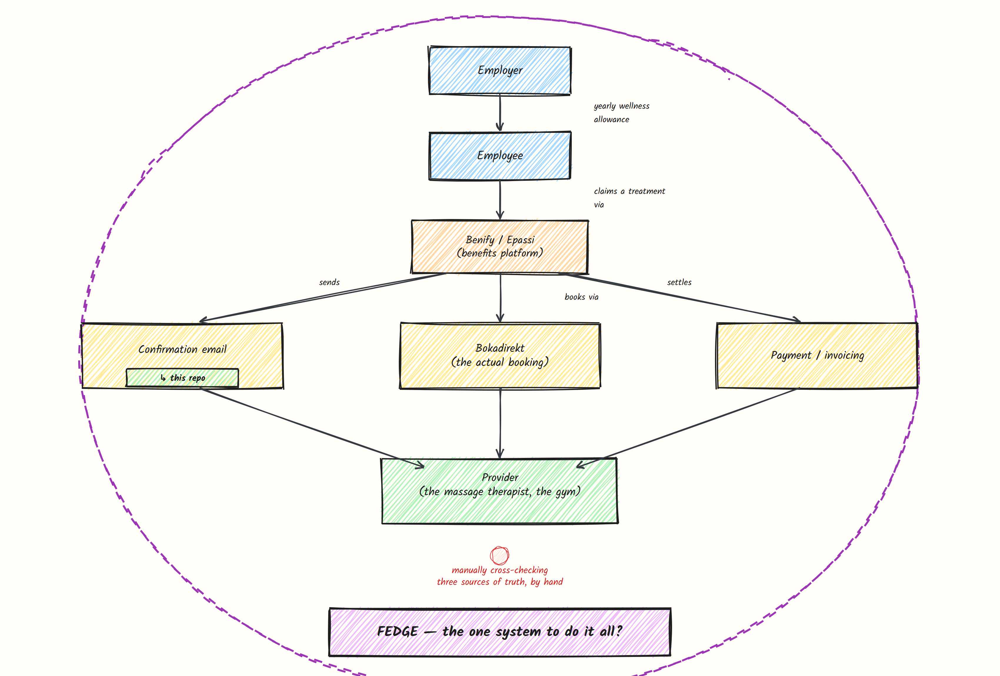
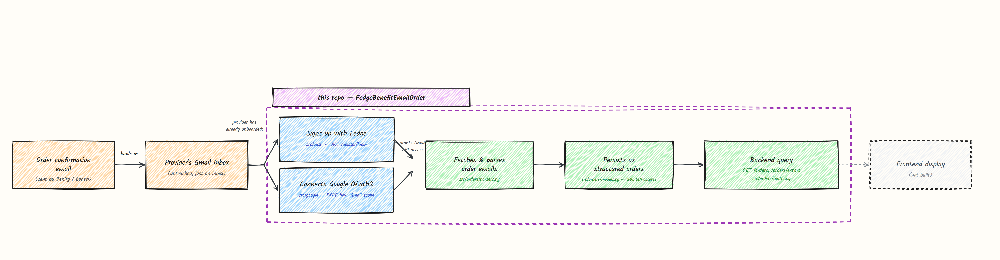
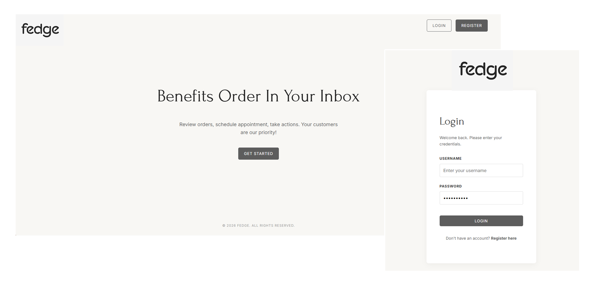
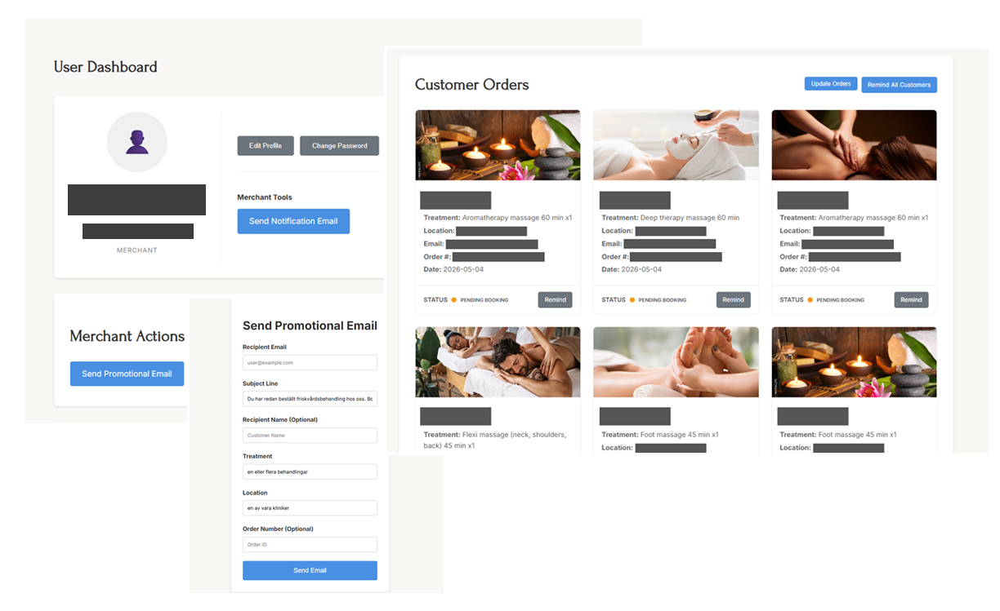
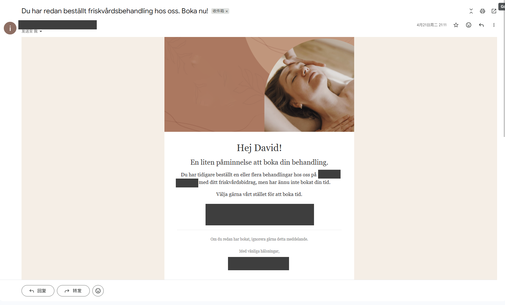
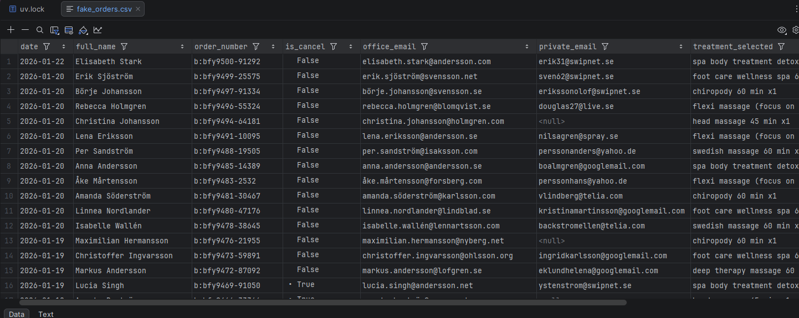
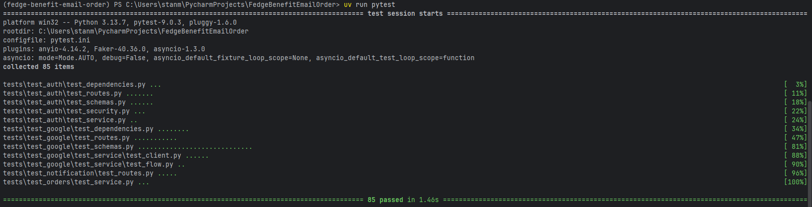

**A FastAPI backend that turns Gmail order-confirmation emails into structured records and reminder emails
for a real small business.**

**This is a read-only portfolio snapshot.**

### The problem

Employees at large Swedish companies often get a yearly wellness allowance to spend on things like massage
therapy, gym memberships, or other wellness treatments. **Benefits platforms: Benify, Epassi, Söderberg &
Partners, and others coordinate that allowance** between the employer and whatever treatment provider the 
employee chooses.

What those platforms don't give the treatment providers (the massage therapist, the gym), is a clean 
order pipeline. All they get is an email confirmation. And the actual booking is a separate concern entirely, handled
through Bokadirekt, **which has no direct link back to the benefits platform's confirmation email.**



*'If only there was one place to manage all these transactions.'*



This project started as the first piece of that: reading the order confirmation emails out of Gmail and
turning them into structured, queryable data. See [here](#read-more-if-you-want-to-know) for why it
stopped there.

> *This is a scoped, read-only extraction of a bigger project. The code runs and the tests pass, but it
isn't hosted anywhere. Every name, email, and business identifier in this repo and its screenshots is
mocked.*

---
## Gallery

### The original app
The full version had a server-rendered dashboard bolted onto the same FastAPI backend. All showcase pictures
will be redacted where sensitive information is concerned. 



> *Login page to the right. Main page to the left. Both very barebone WIP!*



> *Each merchant (providers) have their own individual dashboard, wherein they can view their
customer orders (parsed confirmation emails), and take actions as needed.*



> *An example of the reminder email being sent, redacted to hide specific business information.*

### This repo


> *The abridged, API-only surface for this cut app.*



> *Example mock exported .csv after parsing the emails (NO ACTUAL CUSTOMER DATA IN HERE).*



> *All tests passed, from OAuth2, to notification, to orders.*

---
## Project Structure

```
fedge-benefit-email-order/
├── src/
│   ├── auth/            # JWT login/register, role-gated route protection
│   ├── google/          # OAuth2/PKCE flow + Gmail API client
│   ├── orders/          # per-vendor email parsing, persistence, CSV export
│   ├── notification/    # reminder email rendering + sending (Resend/Mailtrap)
│   ├── exceptions.py    # app-wide generic-error-response handler
│   └── main.py
├── tests/               # 85 tests across all four domains
├── alembic/             # schema migrations
└── assets/
    ├── generate_synthetic_orders.py   # writes synthetic order data, used for the screenshots above
    ├── sample_data/                   # fake_orders.csv / fake_orders.json
    └── img/                           # README screenshots
```

---
## Running it yourself

Needs Python 3.13+ and [`uv`](https://docs.astral.sh/uv/).

```bash
uv sync
cp .env.example .env                                  # fill in a SECRET_KEY; SQLite works out of the box
uv run python assets/generate_synthetic_orders.py   # optional: regenerates the synthetic sample CSV
uv run uvicorn src.main:app --reload
```

Open `http://127.0.0.1:8000/docs` and play around with the Swagger UI. 

Most of the features e.g. sending mails, checking emails, exporting CSVs will not be available. This
repo is simply a shell. You can get them to work by making your own account for the services 
coded in here (Resend for sending emails, Gmail for parsing emails, etc.) and then fill them in your own 
copy of the .env file.

---
**Built with** --> FastAPI | SQLAlchemy 2.0 (async) | Pydantic v2 | Alembic | pytest

**Also used** --> uv | Jinja2 | Resend | Mailtrap | Faker | And more...

License: MIT — see [LICENSE](LICENSE).
