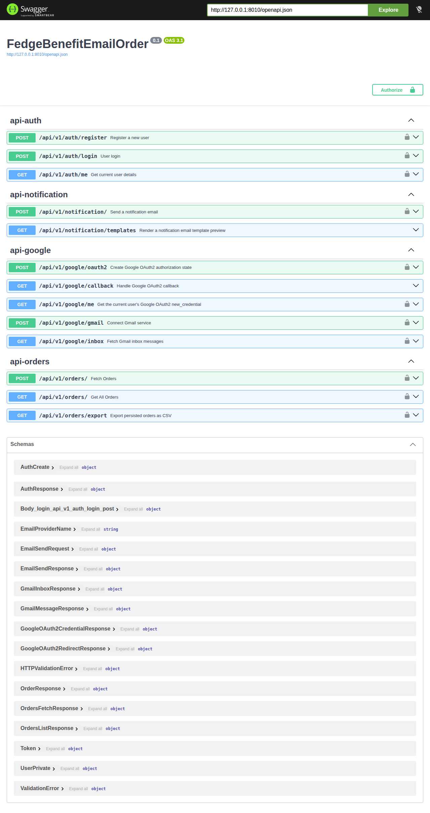

# FEDGE — Benefit Order Email Pipeline

A FastAPI backend that reads order confirmation emails from a benefits platform (e.g. Benify, Epassi, Söderberg & Partners, Eden Red), parses them into structured records, and prepares reminder emails for customers who haven't booked their treatment yet.

This is a scoped extraction from a larger personal project. It's presented here as a **read-only portfolio snapshot**: the code runs, the tests pass, and the screenshots below are real output from this exact repo — but it isn't hosted anywhere, because getting an OAuth-gated Gmail integration safely running as a public live demo wasn't worth the engineering time for a project that's since been retired. See [Distribution & security notes](#distribution--security-notes) for why that's a deliberate choice, not a shortcut.

## The stakeholder problem

I built the original version of this for a family member who runs a small wellness studio in Sweden. Swedish employers commonly give staff a yearly wellness allowance ("friskvårdsbidrag") that employees spend through third-party benefits platforms — Benify, Epassi, and others. When a customer books a treatment through one of these platforms, the studio doesn't get a phone call or a walk-in; it gets an automated confirmation email, and it's on the studio to notice it, log it, and follow up if the customer never actually shows up to book.

At the volume this studio was operating at, that meant manually reading order emails out of a Gmail inbox, cross-referencing them against a booking calendar, and remembering to nudge customers who'd claimed a treatment but hadn't scheduled it. It's tedious, error-prone, and entirely unnecessary busywork for someone running a small business. That was the actual job to be done: turn "read email → notice pattern → act" into something a computer does reliably.

## Initial planning

I had a choice between Flask, Django, and FastAPI. I went with FastAPI for two reasons: the project was fundamentally about data — parsing, storing, transforming — not serving HTML, so Django's full MVC/templating stack was more than I needed; and FastAPI's async-first design plus Pydantic-based validation was the stack I actively wanted to get fluent in. That second reason matters here as an honest signal of what this project was: a real problem, but also a deliberate learning vehicle.

For structure, I organized the codebase by domain rather than by technical layer, following the pattern described in [zhanymkanov/fastapi-best-practices](https://github.com/zhanymkanov/fastapi-best-practices). Each domain (`auth`, `google`, `orders`, `notification`) owns its own models, schemas, router, service layer, and settings — so a new feature usually means a new folder, not scattered edits across a `models/`, `routers/`, and `services/` directory.

## Technical challenges

**Email format heterogeneity.** Different benefits platforms send structurally different confirmation emails. Some include the customer's phone number; some don't. Field labels, ordering, and even the presence of a cancellable-order flag varied by vendor. The `orders` module's parser (`src/orders/parsers.py`) was built to handle this per-vendor variance rather than assuming one fixed email shape.

**Gmail API cost and scale.** This worked fine for one business checking its own inbox a few dozen times a day. It does not obviously work if the same architecture serves many businesses simultaneously against the Gmail API — quota limits, per-call latency, and API cost all scale with tenant count in a way I never solved. This was one of the two real reasons the project stalled, not a hypothetical one.

**Why this stopped — a data ownership question I never resolved.** The other reason was less technical and more uncomfortable: the customer information flowing through this pipeline — names, emails, treatment selections — technically belongs to the benefits platform (Benify, Epassi, etc.), not to the studio using this tool, and not to me. I was building a system to extract, store, and act on personal data that I wasn't confident I — or the studio — had a clear legal or contractual right to hold onto independently. I didn't have a satisfying answer to "who actually owns this data, and under what terms am I processing it," and I didn't want to keep building on top of an unresolved compliance question. That's the real reason development stopped, more than any of the technical gaps above.

## The solution

The pipeline, as built, is: **Extract → Transform → Load → Export → Notify.**

```
Gmail inbox  ──(google)──▶  raw email  ──(orders.parsers)──▶  structured Order
                                                                      │
                                                                      ▼
                                                          Postgres/SQLite (orders.models)
                                                                      │
                                                    ┌─────────────────┴─────────────────┐
                                                    ▼                                     ▼
                                         GET /orders/export                    POST /notification/
                                         (CSV, working)                    (reminder email, working)
                                                    │                                     │
                                                    └──────────────  not wired  ──────────┘
```

**Extract, Transform, Load** (`google` + `orders`): OAuth2/PKCE against the Gmail API, per-vendor parsing, and idempotent upsert into the database keyed on order number — re-running the fetch never creates duplicates.

**Export** (`orders/router.py` → `GET /api/v1/orders/export`): streams persisted orders back out as CSV. This closes a gap in the original project — the real historical workflow was "look at the database" with no export path at all. This endpoint is new work added specifically for this portfolio extraction.

**Notify** (`notification`): given a customer's name, treatment, and location, renders and sends a reminder email. It supports two interchangeable providers behind one `Protocol` — Resend for production sending, Mailtrap for safe sandboxed testing — so switching providers is a one-line settings change, not a rewrite.

**The honest gap: Export and Notify are not wired together.** There's no code that reads a row from the orders table and automatically fires a reminder email. The real historical workflow was manual: a studio employee would refresh the inbox, let the app fetch and store new orders, export the list to CSV, and manually decide who to email based on that list. I never built the automation that would close that loop — partly the Gmail-scale problem above, partly the data-ownership question, and partly because I stopped before getting there. Both halves work independently and are demonstrated separately below; connecting them was the natural next step this project didn't reach.

## Lessons learned

Organizing by domain instead of by layer was, in hindsight, the right call — most new work really did mean "add a folder," and each domain stayed easy to reason about in isolation. It broke down for genuinely cross-cutting concerns: `auth` is imported by every other domain (`google`, `orders`, `notification` all depend on it for route protection), so it never got to be as self-contained as the pattern wants. That's a real limitation of domain-driven structure, not something I found a clean answer to.

The bigger regret is architectural: the original project also bolted a server-side-rendered frontend (Jinja templates, login/dashboard HTML pages) directly onto this same FastAPI app. FastAPI is not a frontend framework, and making it act like one meant fighting the tool instead of using it. If I rebuilt this today, I'd keep FastAPI strictly as an API and pair it with a proper JS frontend (React/Next.js or similar) instead of asking one framework to do both jobs. That SSR layer is deliberately **excluded** from this extraction — everything in this repo is API-only, and the notification-preview endpoint below renders its own minimal template locally rather than depending on that old shared layer.

## What's in this repo (and what isn't)

| Included | Excluded |
|---|---|
| `auth` — JWT login/register, role-based route protection | `ssr` — server-rendered dashboard/landing pages (see Lessons learned) |
| `google` — OAuth2/PKCE flow, Gmail API client | `users` — admin user-management module, not load-bearing for this story |
| `orders` — email parsing, persistence, CSV export | Real vendor data, real business name, real booking URLs (see below) |
| `notification` — reminder email rendering + sending (Resend/Mailtrap) | Stale tests referencing a pre-refactor schema, and one test file that contained real personal email addresses |

Business identity and booking links have been genericized: the real business name is replaced with "the wellness studio" throughout, and the real Bokadirekt booking URLs are replaced with placeholder `example-booking.test` links. Vendor references (Benify, Epassi, etc.) are kept as examples of real Swedish benefits platforms, since the multi-vendor parsing challenge is part of the engineering story.

## Evidence

All screenshots and output files below live in [`docs/evidence/`](docs/evidence/) and were captured from this exact codebase running locally against a seeded SQLite database of synthetic (Faker-generated, zero real PII) orders.

**API surface** — all four route groups, including the new `/orders/export` endpoint:



**Reminder email, rendered** — genericized business name and booking link, real template output:


**Sample data**, pulled live from the running app against seeded synthetic orders:
- [`sample-orders.json`](docs/evidence/sample-orders.json) — `GET /api/v1/orders/`
- [`orders-export.csv`](docs/evidence/orders-export.csv) — `GET /api/v1/orders/export`
- [`pytest-output.txt`](docs/evidence/pytest-output.txt) — full test suite, 85 passed

## Running it yourself

Requires Python 3.13+ and [`uv`](https://docs.astral.sh/uv/).

```bash
uv sync
cp .env.example .env   # fill in a SECRET_KEY at minimum; SQLite works out of the box
uv run uvicorn src.main:app --reload
```

Then open `http://127.0.0.1:8000/docs` for the interactive API, or run the test suite:

```bash
uv run pytest
```

To seed the database with synthetic demo data instead of connecting a real Gmail account:

```bash
uv run python sample/generate_synthetic_orders.py
```

Real Gmail integration requires your own Google Cloud OAuth client (`GOOGLE_CLIENT_ID`/`GOOGLE_CLIENT_SECRET` in `.env`) with Gmail API scopes enabled — see `.env.example` for the exact settings and a note on why a public demo would need Google's app-verification review to request those scopes.

## Distribution & security notes

This repo contains a real, working OAuth2/PKCE flow and Gmail API client. Cloning it does **not** give someone access to any real account or data — it gives them code that, pointed at *their own* Google Cloud OAuth client, can authenticate a user and call the Gmail API on that user's behalf, same as any tutorial or open-source OAuth example. No credentials, tokens, or client secrets are committed anywhere in this repo; `.env` is git-ignored and only `.env.example` (placeholder values) is tracked.

The original project's local database and `.env` (which would have contained real, if long-expired, OAuth refresh tokens and email-provider API keys) were never carried into this repo — this history starts fresh. As routine hygiene for the retired original project, the real Google OAuth client and email-provider API keys tied to it should be treated as rotated/revoked rather than reused.

## Error response design

Revisiting the API surface for this extraction surfaced a real information-disclosure pattern, not just a hypothetical one: `/auth/register` returned a distinct 409 for a taken username, `/auth/login` returned a distinct 401 for a wrong password, and every bearer-token/role-gated route (`/auth/me`, and everything behind `require_role` — orders, notification, google) returned a distinct 401 vs 403 vs 404 depending on *why* the caller was rejected. None of that was exploited anywhere — this project never had real users — but each of those distinctions is exactly the kind of thing that lets an API be used to enumerate valid usernames, confirm whether a specific account exists, or probe which parts of a system a given token can and can't reach.

The fix was to settle on one rule: an endpoint should never reveal more than success or failure. Concretely, that means two fixed, generic responses now cover every failure case in `auth`, `notification`, and `google`:

- `422 {"detail": "Invalid request."}` for `/register` and `/login` — a taken username, a wrong password, an unknown username, being already logged in, and a malformed request body are all indistinguishable from the outside.
- `404 {"detail": "Not found."}` for every bearer-token/role-gated route — a missing token, an expired or malformed token, a token for a deleted user, and a valid token with the wrong role are all indistinguishable. This is deliberately the same pattern GitHub uses for private repos you can't access: 404 instead of 403, so the response doesn't even confirm the resource exists.

The internal exception classes that used to map one-to-one with those distinct HTTP statuses — `UserNotFound`, `MalformedToken`, `UnauthenticatedUser`, `InsufficientPermission`, `UsernameAlreadyExists`, `AlreadyAuthenticated`, and so on — are still there, and deliberately weren't collapsed into one exception type just because their HTTP responses were. A few reasons that held up under scrutiny:

- **Tests still need the precision.** `tests/test_auth/test_dependencies.py` and `tests/test_google/test_dependencies.py` assert things like `pytest.raises(InsufficientPermission)` at the dependency layer, independent of what the HTTP layer does with it. That's a stronger regression check than "some auth exception was raised" — it catches a bug where, say, a deleted-user case gets misclassified as a malformed-token case, even though both produce the identical response externally.
- **Internal observability shouldn't be as blind as the external response.** The whole point of the change is that the *caller* shouldn't be able to tell these cases apart. The operator running the server still benefits from being able to tell them apart in logs, error tracking, or metrics — that's a different audience with a legitimate reason to know more.
- **It keeps two different concerns in two different places.** The dependency/service layer's job is to say *why* something failed, in domain terms. The exception handler's job is to decide what the caller is allowed to learn from that. Merging the exception classes would bake a security/presentation policy into business logic — coupling that gets easy to get wrong later, since a new failure mode would have no distinct class to prompt the question "should this be generic too?"
- **The mapping stays reversible.** Because the collapsing happens entirely in each domain's `ExceptionHandler` (see `auth/exceptions.py`, `google/exceptions.py`), changing which failures share a response is a one-place edit, not a hunt through every raise site in the codebase.

The trade-off is real and worth stating plainly: a legitimate caller loses some debuggability. A login typo now looks identical to a taken username; a genuinely missing OAuth credential looks identical to an expired token. That's the deliberate cost of removing the enumeration surface, not an oversight.

## License

MIT — see [LICENSE](LICENSE).
